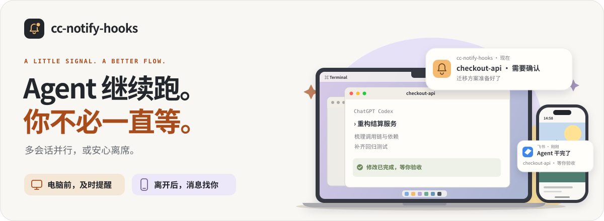

<p align="center">
  <a href="https://mariozzj.github.io/cc-notify-hooks/">
    <picture>
      <source media="(prefers-color-scheme: dark)" srcset="docs/assets/readme-hero-dark.svg">
      <source media="(prefers-color-scheme: light)" srcset="docs/assets/readme-hero-light.svg">
      
    </picture>
  </a>
</p>

<h1 align="center">cc-notify-hooks</h1>

<p align="center">
  <strong>Agent 继续跑。你不必一直等。</strong><br>
  为 Claude Code、ChatGPT Codex、DeepSeek Harness 与 Magpie 接入桌面和手机通知。<br>
  需要你回复、确认或验收时，让一条消息把你叫回来。
</p>

<p align="center">
  <a href="https://github.com/MarioZZJ/cc-notify-hooks/releases"></a>
  <a href="LICENSE"></a>
  <a href="#支持的渠道"></a>
</p>

<p align="center">
  <a href="https://mariozzj.github.io/cc-notify-hooks/"><strong>项目主页</strong></a> ·
  <a href="#安装">开始安装</a> ·
  <a href="#配置">配置通知</a> ·
  <a href="#文档">完整文档</a>
</p>

## 让提醒跟上你的工作节奏

| 长通知 · 离开电脑，也能及时回来 | 短通知 · 多个窗口，各自推进 |
| --- | --- |
| 把复杂任务交给 Agent，去喝杯咖啡、做点别的。手机收到消息，打开看到项目和结果摘要，再回电脑验收。 | 同时推进几个项目，不必轮流查看每个窗口。右上角的系统通知告诉你谁在等待，切回对应会话继续处理。 |
| [观看长通知场景 ↗](https://mariozzj.github.io/cc-notify-hooks/demo.html?scene=long) | [观看短通知场景 ↗](https://mariozzj.github.io/cc-notify-hooks/demo.html?scene=short) |

<a id="为什么需要分级通知"></a>
<a id="工作原理"></a>

- **提醒有先后。** 秒级渠道先到，分钟级渠道随后送达；每个渠道都能单独设置延迟与事件。
- **会话各自独立。** 一个项目需要处理时，其他会话继续工作，通知队列按会话隔离。
- **回来处理，就取消后续待发提醒。** 宿主报告新输入、提问结束等活动后，清除对应待发标记；已经发出的消息保留。

通知延迟从插件收到事件开始计算。真实事件范围与取消时机见[兼容性说明](docs/compatibility.md)。

## 安装

### 让 Agent 帮你安装

将下面这段话发给你正在使用的 Agent，它可以读取[纯文本安装指南](https://mariozzj.github.io/cc-notify-hooks/llms.txt)，按当前环境完成接入：

```text
请读取 https://mariozzj.github.io/cc-notify-hooks/llms.txt，
帮我在当前使用的 Agent 中安装并配置 cc-notify-hooks。

优先根据环境确认接入方式；无法确定时再问我。
保留已有 hooks 和通知配置，按我需要的渠道完成配置，
最后告诉我启用情况和生效步骤。
```

### 手动安装

先确保运行插件的环境有 **Bash、`jq` 和 `curl`**。macOS 原生通知通过 `osascript` 发送；`jq` 可使用 `brew install jq` 或 `apt install jq` 安装。

选择你使用的宿主。ChatGPT Codex 接入要求运行环境支持**本地插件与 hooks**，下面保留终端安装命令及桌面端审阅入口。

<details open>
<summary><strong>Claude Code</strong> · 插件市场安装</summary>

在 Claude Code 2.1.275 及以上版本中执行：

```text
/plugin install cc-notify-hooks --marketplace MarioZZJ/cc-notify-hooks
```

随后运行 `/reload-plugins`，再执行 `/cc-notify-hooks:config` 选择渠道、填写凭据与设置延迟。

也可[分两步注册来源并安装](docs/getting-started.md#claude-code)。

</details>

<details>
<summary><strong>ChatGPT Codex</strong> · 本地插件与 hooks</summary>

在终端中执行：

```bash
codex plugin marketplace add MarioZZJ/cc-notify-hooks
codex plugin add cc-notify-hooks@cc-notify-hooks
```

启动新会话，在 `/hooks` 中审阅并信任 hooks；桌面端使用 **Settings > Hooks**。随后使用插件的 `config` 技能或安装后的 setup 入口配置渠道。

命令行 0.169.0 的 hooks 默认开启；若此前关闭过，请在 `${CODEX_HOME:-~/.codex}/config.toml` 中恢复 `[features].hooks = true`。插件脚本升级后需要重新审阅。完整步骤见 [ChatGPT Codex 安装说明](docs/getting-started.md#chatgpt-codex)。

</details>

<details>
<summary><strong>DeepSeek Harness</strong> · 原生插件</summary>

在终端中执行：

```bash
git clone https://github.com/MarioZZJ/cc-notify-hooks.git
cd cc-notify-hooks
bash install.sh dsh web
```

启用渠道并填写 `${DSH_HOME:-~/.dsh}/cc-notify-hooks/notify.json`。包名为 `dsh-notify-hooks`，使用 0.2.2-rc.3 或更新的兼容版本；未开启 HMR 时重启对应宿主。

桌面版附带的命令可安装到已初始化的 `desktop` profile；普通 npm CLI 不支持管理该 profile。另有[自定义插件索引与桌面版安装说明](docs/getting-started.md#deepseek-harness)。本地安装后请保留仓库目录。

</details>

<details>
<summary><strong>Magpie</strong> · 网关 hook 插件</summary>

在终端中执行：

```bash
git clone https://github.com/MarioZZJ/cc-notify-hooks.git
cd cc-notify-hooks
bash install.sh magpie
```

启用渠道并填写 `~/.config/cc-notify-hooks/notify.json`。包名为 `agent-notify-hooks`，建议使用 0.1.4174 或更新的兼容版本。本地安装后请保留仓库目录。

Magpie 通知表示**模型响应完成或模型请求异常**；一次模型响应可能只是 Agent 任务的一步。完整配置、远程安装及事件说明见 [Magpie 安装指南](docs/getting-started.md#magpie)。

</details>

<a id="方式五本地-claude-插件模式"></a>
<a id="方式六claude--codex-独立安装"></a>

其他入口：[Claude 本地插件模式](docs/getting-started.md#claude-本地插件模式) · [Claude / ChatGPT Codex 独立安装](docs/getting-started.md#独立安装) · [更新、迁移与卸载](docs/getting-started.md#更新与迁移)

## 配置

Claude Code 可运行 `/cc-notify-hooks:config`；ChatGPT Codex 可使用插件的 `config` 技能。DeepSeek Harness 与 Magpie 直接编辑安装步骤中列出的配置文件。[配置路径与完整字段](docs/configuration.md)中也提供手动设置方法。

下面是“桌面及时提醒 + 飞书离席通知”的示例，填写自己的 Webhook 后再启用：

```json
{
  "channels": {
    "macos": {
      "enabled": true,
      "delay": 3,
      "events": ["notification", "stop"]
    },
    "feishu": {
      "enabled": true,
      "delay": 300,
      "events": ["notification", "stop"],
      "format": "card",
      "webhook": "https://open.feishu.cn/open-apis/bot/v2/hook/your-token"
    }
  },
  "rate_limit": 10
}
```

**默认配置更安静：**[配置模板](plugins/cc-notify-hooks/config/notify.example.json)只启用 macOS 的 `notification`，其他渠道默认关闭。上面的示例额外订阅 `stop`，接收原生 Agent 的正常回合结束提醒。

`notification` 覆盖等待确认、结构化提问、异常，以及 Magpie 的网关响应；`stop` 用于原生 Agent 的正常回合结束。长通知的默认延迟为插件收到事件后的 5 分钟，可按自己的工作习惯调整。各渠道凭据的获取方法见[配置指南](docs/configuration.md#渠道凭据)。

## 支持的渠道

| 渠道 | 默认延迟 | 适合的接收方式 |
| --- | --- | --- |
| macOS | 3 秒 | 本机系统通知 |
| Telegram | 5 秒 | Bot 消息 |
| Bark · Pushover · ntfy · Gotify | 15 秒 | 手机推送、跨平台推送或自建服务 |
| 企业微信 · 飞书 · 钉钉 · Slack · Discord | 5 分钟 | 工作群与异步消息 |

11 个渠道均可独立启用、设置延迟与筛选事件。[查看每个渠道的格式与凭据 →](docs/configuration.md#渠道与默认值)

## 常见问题

<details>
<summary><strong>点击通知，能直接跳回 Agent 吗？</strong></summary>

通知提供项目和上下文，返回对应会话由你手动完成。手机通知可打开相应消息应用；当前没有会话直达链接或手机远程审批功能。

</details>

<details>
<summary><strong>已经回来处理，还会继续提醒吗？</strong></summary>

宿主报告后续输入、提问结束或支持的工具事件后，会取消该会话尚未发送的提醒。具体时机取决于宿主信号；仅查看通知不会触发取消。[事件与取消边界](docs/configuration.md#事件覆盖与取消)列出了各入口的行为。

</details>

<details>
<summary><strong>在远程服务器运行，也能收到通知吗？</strong></summary>

发送脚本在执行 hook 的环境运行。该环境具备 Bash、`jq`、`curl` 并能访问所选渠道时，可发送手机或工作群消息。macOS 原生通知由运行脚本的 Mac 发出；远程环境可选用推送渠道。

</details>

<details>
<summary><strong>应该装原生插件，还是 Magpie 插件？</strong></summary>

需要等待确认、结构化提问和回合结束信息时，选择对应 Agent 的原生入口。需要观察经过 Magpie 的模型请求时，选择网关插件。两个入口同时启用会分别通知；适配版本、事件范围与市场状态见[兼容性说明](docs/compatibility.md)。

</details>

## 文档

| 你想做什么 | 从这里开始 |
| --- | --- |
| 安装、更新、迁移或卸载 | [安装指南](docs/getting-started.md) |
| 配置渠道、凭据、延迟与事件 | [配置指南](docs/configuration.md) |
| <a id="事件覆盖与取消"></a><a id="监听事件"></a><a id="通知内容"></a>了解通知内容与取消时机 | [事件与通知内容](docs/configuration.md#事件覆盖与取消) |
| 核对宿主版本与插件市场状态 | [兼容性说明](docs/compatibility.md) |
| <a id="过滤规则"></a><a id="文件结构"></a>理解实现、测试或排查问题 | [开发与排错](docs/development.md) |
| <a id="卸载"></a>移除插件 | [卸载说明](docs/getting-started.md#卸载) |
| <a id="插件市场"></a>维护目录提交与分发 | [分发参考](docs/development.md#插件分发) |

## License

[MIT](LICENSE) · Made by [MarioZZJ](https://github.com/MarioZZJ)
